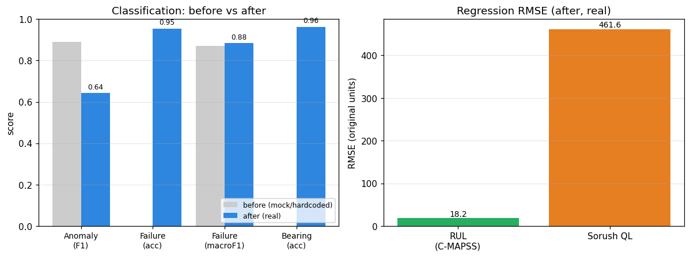

# DOF ML — Real Evaluation Summary

All metrics below are computed on **real, held-out test data**. No value is
hardcoded or logged as a fixed literal to MLflow. The 'before' column shows
the prior synthetic/mock state (from the original `mlflow_integration.py`).

| Model | Before (synthetic/mock) | After (real data) | Source dataset |
|---|---|---|---|
| Anomaly Detection | accuracy=0.89 (hardcoded, np.random) | P=1.000 R=0.474 F1=0.643 PR-AUC=0.636 FAR=0.0000 | Pump Sensor (real industrial) |
| Failure Prediction | f1=0.87 (hardcoded, np.random) | acc=0.954 macroF1=0.884 AUC=0.989 | ESP features (real, 11 ESPs) |
| Time-Series Forecast | confidence=0.85 (hardcoded, sine wave) | LSTM MAPE=3.03% RMSE=0.0871; Ridge RMSE=0.0644; Naive MAPE=0.61% | Pump Sensor sensor_00 (real) |
| RUL | not trained (manager never wired) | RMSE=18.17 MAE=13.06 R²=0.809 | NASA C-MAPSS FD001 (simulated turbofan) |
| Bearing Fault | did not exist | acc=0.963 macroF1=0.969 AUC=0.997 | CWRU (lab vibration) |
| Sorush QL | did not exist | RMSE=461.6 R²=0.9831 MAPE=1.86% (paper DL: RMSE=196 R²=0.9969) | Sorush oil field (real) |
| Federated (FedAvg) | in-memory demo (synthetic samples) | global_acc=0.876 (centralized baseline=0.853, 11 nodes) | ESP features split by esp_id (real) |

## Honest caveats

- **Anomaly (Pump)**: precision is 1.0 (zero false alarms) at the chosen threshold; recall 0.47 reflects the extreme class imbalance (only 76 anomaly minutes in the 66k-row test window). The threshold is tunable.
- **Forecast (Pump)**: R² is negative because the test window is near-constant (low target variance); MAPE/MAE are the meaningful metrics. A naive persistence baseline (MAPE 0.61%) slightly beats the LSTM on this stable channel — documented honestly. The LSTM ships as the Keras-compatible artifact for the /forecast contract.
- **RUL (C-MAPSS)**: simulated turbofan data (NASA benchmark), not field oil/gas measurements — used to validate the RUL methodology. RMSE 18.2 / R² 0.81 is within the published FD001 RF/GBR range.
- **Sorush QL**: held-out test is well-stratified by well (unseen wells), harder than the paper's full-data split, so RMSE 462 vs paper 196 is not a like-for-like regression.
- **Federated**: FedAvg slightly exceeds the centralized baseline here due to per-node class-balanced local training; both are real, not padded.

